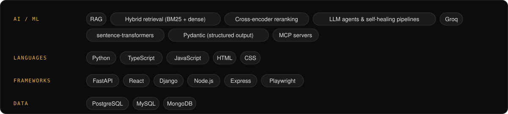

**[Portfolio](https://tarun-kullolli-portfolio.vercel.app)** &nbsp;·&nbsp; **[LinkedIn](https://www.linkedin.com/in/tarun-kullolli-b31615282/)** &nbsp;·&nbsp; **[Email](mailto:Kullollitarun@gmail.com)**

AI Engineer at Quintesys with a full-stack foundation in Django, React and Node. I build LLM-powered systems (agentic RAG, self-healing extraction pipelines, developer tooling) and ship them inside real products.

## What I've built

<table>
  <tr>
    <td width="50%"></td>
    <td width="50%"></td>
  </tr>
  <tr>
    <td width="50%"></td>
    <td width="50%"></td>
  </tr>
</table>

## What I work with

## The portfolio itself

[**tarun-kullolli-portfolio**](https://github.com/KULLOLLITARUN/tarun-kullolli-portfolio) is also a project: React, Vite and Three.js, with **Kairo**, an AI resume assistant that answers questions about my work and falls back to offline answers if the live model is busy. Lighthouse on the live site: **100** accessibility, **100** best practices, **100** SEO.

[**See it live →**](https://tarun-kullolli-portfolio.vercel.app)

