**[Portfolio](https://tarun-kullolli-portfolio.vercel.app)** &nbsp;·&nbsp; **[LinkedIn](https://www.linkedin.com/in/tarun-kullolli-b31615282/)** &nbsp;·&nbsp; **[Email](mailto:Kullollitarun@gmail.com)**

AI Engineer at Quintesys with a full-stack foundation in Django, React and Node. I build LLM-powered systems (agentic RAG, self-healing extraction pipelines, developer tooling) and ship them inside real products.

## What I've built

| Project | What it does | Built with |
| --- | --- | --- |
| **[Archiva](https://github.com/KULLOLLITARUN/Archiva)** | Self-hosted document Q&A that answers only from your documents, using hybrid retrieval, reranking and a self-healing retry loop. | Python, FastAPI, PostgreSQL, Groq, React |
| **[PBIP Sentinel](https://github.com/KULLOLLITARUN/Power-BI-Report-Quality-Performance-Scanner)** | Static analysis and CI quality gate for Power BI projects. 94/94 true positives across 11 real models. [Live demo](https://pbip-sentinel.netlify.app/) | Python, TypeScript, MCP, SARIF |
| **[Markpull](https://github.com/KULLOLLITARUN/Agentic-Web-Scraper)** | Say what you want from a web page in plain words and get structured data back, with every record marked on the page. | Python, FastAPI, Playwright, Groq, React |
| **[AI Impact](https://github.com/KULLOLLITARUN/ai-impact)** | Change-impact and test-gap analysis for Python. Every number in a report traces back to the diff and the call graph. | Python, MCP, Gemini, Groq |

## What I work with

**AI / ML:** RAG, hybrid retrieval (BM25 + dense), cross-encoder reranking, LLM agents, MCP servers, Groq, sentence-transformers, Pydantic
**Languages:** Python, TypeScript, JavaScript, HTML, CSS
**Frameworks:** FastAPI, React, Django, Node.js, Express, Playwright
**Data:** PostgreSQL, MySQL, MongoDB

## The portfolio itself

[**tarun-kullolli-portfolio**](https://github.com/KULLOLLITARUN/tarun-kullolli-portfolio) is also a project: React, Vite and Three.js, with **Kairo**, an AI resume assistant that answers questions about my work and falls back to offline answers if the live model is busy. Lighthouse on the live site: **100** accessibility, **100** best practices, **100** SEO.

[**See it live →**](https://tarun-kullolli-portfolio.vercel.app)

